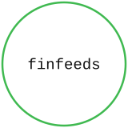
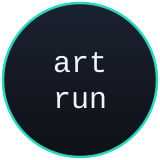
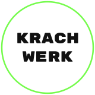
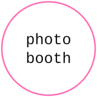
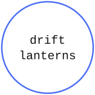

<table align="center">
<tr><th colspan="2">CONTACT</th></tr>
<tr>
<td align="center"></td>
<td align="center"></td>
</tr>
</table>

<table align="center">
<tr><th colspan="5">PROJECTS</th></tr>
<tr>
<td align="center"></td>
<td align="center"></td>
<td align="center"></td>
<td align="center"></td>
<td align="center"></td>
</tr>
</table>
