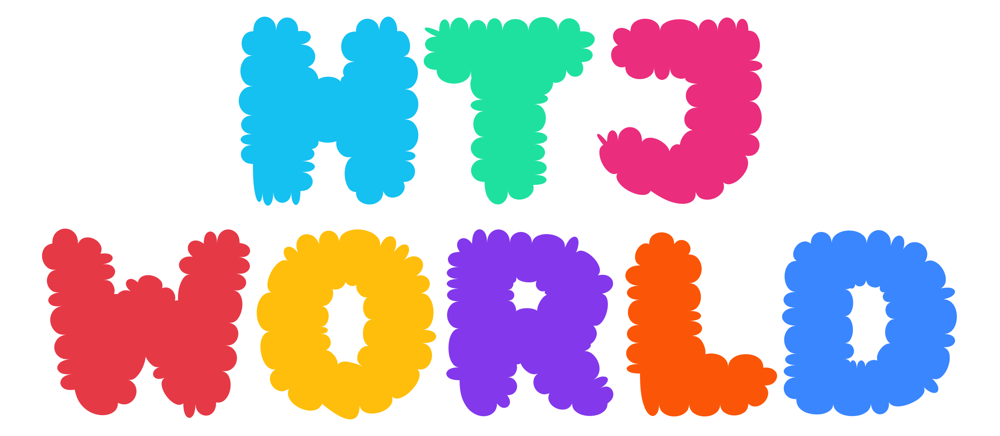

 

<table align="center">
<tr><th colspan="2">CONTACT</th></tr>
<tr>
<td align="center"></td>
<td align="center"></td>
</tr>
</table>

<table align="center">
<tr><th colspan="6">PROJECTS</th></tr>
<tr>
<td align="center"></td>
<td align="center"></td>
<td align="center"></td>
<td align="center"></td>
<td align="center"></td>
<td align="center"></td>
</tr>
</table>

<h3 align="center">MERGE STICKERS</h3>

<!--MERGE-STICKERS:START-->

<picture><source media="(prefers-color-scheme: dark)" srcset="assets/merge-stickers/header-dark.svg?v=44d104"></picture>

<picture><source media="(prefers-color-scheme: dark)" srcset="assets/merge-stickers/slots/7-dark.svg?v=cfc36c"></picture><picture><source media="(prefers-color-scheme: dark)" srcset="assets/merge-stickers/slots/8-dark.svg?v=a58775"></picture><picture><source media="(prefers-color-scheme: dark)" srcset="assets/merge-stickers/slots/9-dark.svg?v=1ac88d"></picture><picture><source media="(prefers-color-scheme: dark)" srcset="assets/merge-stickers/slots/10-dark.svg?v=34e9c8"></picture>

<!--MERGE-STICKERS:END-->
